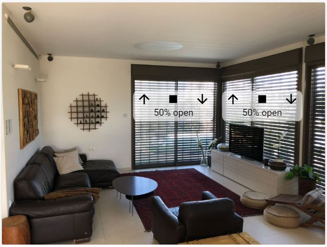
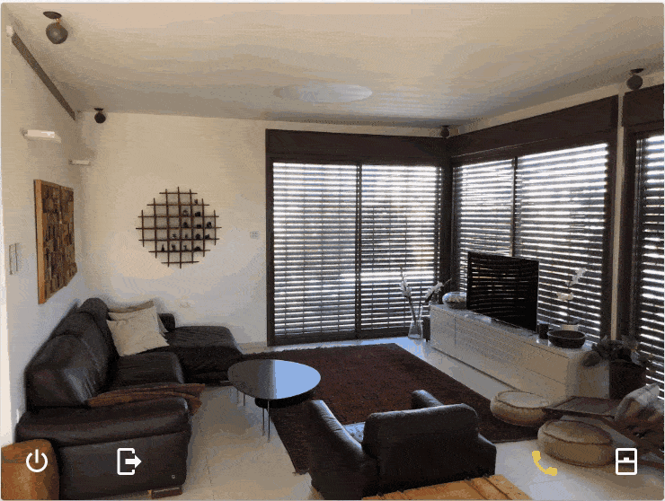
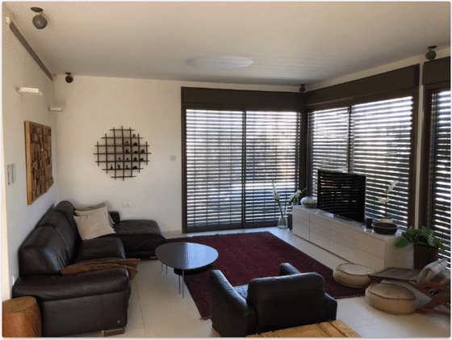

# Group Element

An element to group other elements in [Home Assistant](https://github.com/home-assistant/home-assistant) [picture-elements](https://www.home-assistant.io/lovelace/picture-elements/) with dynamic toggle capability.

Perfect for creating dynamic interfaces while reusing UI real-estate.

| Turn this: | In to this (adding many controls) |
|------|------|
| </a> | <a href="https://youtu.be/1lgNFSjI4cA"></a>

## Using the element

There are many possible uses for the group element. Examples are included below.

1. Build a cleaner interface by showing controls only when a hot spot is tapped. For example, tap a cover or dimmer to reveal its controls.
2. Position a set of controls once, relative to the group, and then move or resize the whole group together.
3. Build a dynamic interface such as a compact universal remote control for a TV, receiver, and set-top box.
4. Toggle parts of the interface locally without creating shared `input_boolean` helper entities.

## How the group works

A group has two kinds of child elements:

- `elements` are the main contents of the group. They are shown or hidden together.
- `toggle_area_elements` remain on the screen when the main contents are hidden. They can show the user where to tap to open the group again.

The component has three practical modes. The visual editor selects the mode for you and sets `toggle_tap`, `elements_pos`, and `toggle_area_elements` as needed.

### Mode 1: Toggle hotspot

Use this when you want an empty, possibly invisible, area that opens and closes another set of elements.

- `toggle_tap` is `true`.
- `style` defines the size and position of the clickable hotspot.
- The hotspot has no `toggle_area_elements`.
- `elements_pos` styles a separate container holding the elements that are shown and hidden.

```text
picture-elements
|-- group-element (empty clickable hotspot, always present)
`-- elements_pos container (present while shown)
    `-- elements
```

### Mode 2: Toggle area including elements

Use this when the clickable area contains icons, labels, buttons, or other elements that should always remain visible. Tapping that area shows or hides another set of elements.

- `toggle_tap` is `true`.
- `style` defines the clickable toggle area.
- `toggle_area_elements` live inside that area and remain present when the main contents are hidden.
- `elements_pos` styles a separate container holding the elements that are shown and hidden.

```text
picture-elements
|-- group-element (clickable toggle area, always present)
|   `-- toggle_area_elements (always present)
`-- elements_pos container (present while shown)
    `-- elements
```

The `toggle_area_elements` do not toggle the group by themselves. A click on them normally bubbles up to the surrounding `group-element`, which is the actual clickable toggle area.

### Mode 3: No toggle

Use this simply to keep several picture-elements children together. There is no show/hide action when the group is tapped.

- `toggle_tap` is `false`.
- There is no `elements_pos` container.
- `style` positions and sizes the group itself.
- `elements` live directly inside the group and are positioned relative to it.

```text
picture-elements
`-- group-element (positioned by style)
    `-- elements
```

This is useful when several controls should share one position, size, or coordinate system and move together as one group.

### What the containers mean

The outer `style` always styles the `group-element` itself. Its role depends on the selected mode:

- In Toggle hotspot mode it styles the empty hotspot.
- In Toggle area including elements mode it styles the always-present toggle area.
- In No toggle mode it styles the fixed group containing the elements.

In either toggle mode, `elements_pos` creates and styles a separate container for the main `elements`. This container is positioned relative to the picture-elements card, not relative to the toggle area. Hiding the group removes this separate container and its elements from the displayed card; showing it restores them.

Because Mode 3 places the regular elements directly inside the group, clicks on them can bubble up to the group. This does not toggle anything because `toggle_tap` is disabled.

### What toggles the group

The `toggle_area_elements` do not implement the toggle themselves. The `group-element` is the clickable toggle area.

- `toggle_tap: true` enables click-to-toggle behavior for the group.
- Clicking anywhere inside the `group-element` toggles the regular `elements`.
- A click on a `toggle_area_elements` child also toggles the group because the click bubbles up to the group.
- The toggle-area children are persistent visual controls or indicators inside the clickable area.
- The group host remains present when the main contents are hidden, so an empty but sized group can also act as an invisible hot spot.
- `no_toggle_hide: true` creates tab-like behavior: a tap can show the group, but tapping the open group again does not hide it.

The `visible` property controls the initial state of the regular `elements`; it does not remove the group host or its `toggle_area_elements`.

## Configuration reference

### Element options

| Name | Type | Default | Since | Description |
|------|------|---------|-------|-------------|
| `type` | string | **required** | v0.1 | Must be `custom:group-element`. |
| `elements` | list | **required** | v0.1 | The regular picture-elements children that are shown and hidden together. |
| `style` | object | — | v0.1 | Positions and sizes the group itself: the hotspot in Mode 1, toggle area in Mode 2, or fixed group in Mode 3. |
| `elements_pos` | object | — | v0.1 | In either toggle mode, creates a separate container for the toggled `elements` and applies these CSS properties to it. |
| `toggle_area_elements` | list | empty | v0.3 | Picture-elements children that stay inside the group and remain present when the regular elements are hidden. |
| `toggle_tap` | boolean | `false` | v0.1 | Allows a click inside the group to toggle the regular elements. |
| `visible` | boolean | `true` | v0.1 | Sets the initial visibility of the regular elements. |
| `visible_style` | object | — | v0.3 | CSS properties applied to the group while it is visible. Each property is applied with `!important`. |
| `grouping_code` | string or number | — | v0.1 | When this group is toggled and shown, hides the toggled contents of sibling groups with the same value. The participating groups should have `toggle_tap` enabled. |
| `no_toggle_hide` | boolean | `false` | v0.3 | Provides tab-like behavior: a tap can show the group but cannot hide it again while it is open. |
| `fully_hide_other_groups_on_show` | boolean | `false` | v0.3 | With a `grouping_code`, also hides matching sibling group hosts, including their always-shown toggle-area elements. |
| `close_button` | object | — | v0.1 | Configures an optional close button placed with the regular elements. |
| `hide_when` | object | — | — | Hides a visible group when the configured entity has the configured state. See below. |

### Entity-state hiding (`hide_when`)

`hide_when` has two properties:

| Name | Type | Default | Description |
|------|------|---------|-------------|
| `entity` | string | **required** | Entity ID to watch. |
| `state` | string | **required** | Exact state value that hides the group. |

Example:

```yaml
hide_when:
  entity: input_boolean.hide_controls
  state: "on"
```

This condition hides the group when the state matches. It does not automatically show the group when the state stops matching; the group must then be shown by a user click or by calling its `show()` method.

### Elements position options (`elements_pos`)

Use this object when the regular elements should appear somewhere other than inside the toggle area. Every entry is applied as a CSS property to the separate elements container.

**All coordinates in this object are relative to the group parent (normally the picture-elements card), not to the group.**

| Name | Type | Default | Since | Description |
|------|------|---------|-------|-------------|
| `left` / `right` | string | — | v0.1 | Sets the horizontal position of the container. |
| `top` / `bottom` | string | — | v0.1 | Sets the vertical position of the container. |
| `width` | string | — | v0.1 | Sets the width of the container. |
| `height` | string | — | v0.1 | Sets the height of the container. |
| Any other CSS property | string | — | v0.1 | Applies an additional style, such as `background-color`, `border-radius`, or `transform`. |

### Close button (`close_button`)

Optional button placed with the regular elements. The group must have `toggle_tap: true` for its current close behavior.

| Name | Type | Default | Since | Description |
|------|------|---------|-------|-------------|
| `show` | boolean | `false` | v0.1 | Shows the close button. |
| `icon` | string | `hass:close` | v0.1 | Sets the icon shown on the button. |
| `style` | object | — | v0.1 | CSS properties used to position and style the button container. |

### Close-button style (`close_button.style`)

Use this object to position and style the close-button container.

| Name | Type | Default | Since | Description |
|------|------|---------|-------|-------------|
| `left` / `right` | string | — | v0.1 | Sets the horizontal position of the close button. |
| `top` / `bottom` | string | — | v0.1 | Sets the vertical position of the close button. |
| `--icon-transform` | string | — | v0.7 | Applies a CSS transform to the icon. Other properties style the button container. |
| Any other CSS property | string | — | v0.1 | Applies an additional style to the button container. |

## Example usage

#### Basic setup
Group controls in a group that is initially hidden and shows when tapped. All elements are within the group.

<a href="https://youtu.be/koFOMzLKpEo"></a>

```yaml
- type: picture-elements
  image: /local/living-room.jpg
  elements:
    type: 'custom:group-element'
    toggle_tap: true
    visible: false
    style:
      height: 40%
      left: 67%
      top: 30%
      width: 25%
    - elements:
      # your elements go here - their size/position is relative to the group
```

#### Elements shown outside of hot spot (toggle area)

To show elements outside of the group area use the elements_pos object. This allows you to define a hot spot (in the group's location) separate to the elements shown when the hot spot is tapped.

<a href="https://youtu.be/4UFbfI1k8r4"></a>

```yaml
- type: picture-elements
  image: /local/living-room.jpg
  elements:
    - type: 'custom:group-element'
      visible: false
      toggle_tap: true
      style:
        # the group style determines the hotspot
        height: 40%
        left: 41%
        top: 30%
        width: 25%
      elements:
        # your elements go here - their size/position is relative to the group
      elements_pos:
        # the elements_pos style determine the location of the elements
        left: 10%
        top: 65%
        width: 80%
        height: 30%
        transform: none
        background-color: 'rgba(255, 255, 255, 0.6)'
        border-radius: 10px
```

#### Close button

You can hide the group by clicking a close button you can add and position

<a href="https://youtu.be/bCJw8mR61Pg"></a>

```yaml
- type: picture-elements
  image: /local/living-room.jpg
  elements:
    - type: 'custom:group-element'
      visible: false
      toggle_tap: true
      style:
        # the group style determines the hotspot
        height: 40%
        left: 41%
        top: 30%
        width: 25%
      elements:
        # your elements go here - their size/position is relative to the group
      elements_pos:
        # the elements_pos style determine the location of the elements
        left: 10%
        top: 65%
        width: 80%
        height: 30%
        transform: none
        background-color: 'rgba(255, 255, 255, 0.6)'
        border-radius: 10px
      close_button:
        # the close button determines the location of the close button
        show: true
        style:
          background-color: 'rgba(255, 255, 255, 0.6)'
          border-color: black
          border-radius: 10px
          border-style: solid
          left: 1%
          top: 69%
          transform: none
```

#### Grouping

When you have multiple groups (group-element) that may reuse the same real estate it makes sense for one of them to hide all others when it is visible.
To do this, set the grouping_code to the same number on all groups that should share the real estate.

<a href="https://youtu.be/cGAN1YqO9hY"></a>

```yaml
- type: picture-elements
  image: /local/living-room.jpg
  elements:
    # first group - with grouping_code of 1
    - type: 'custom:group-element'
      visible: false
      toggle_tap: true
      grouping_code: 1
      style:
        # the group style determines the hotspot
        height: 40%
        left: 41%
        top: 30%
        width: 25%
      elements:
        # your elements go here - their size/position is relative to the group
      elements_pos:
        # the elements_pos style determine the location of the elements
        left: 10%
        top: 65%
        width: 80%
        height: 30%
        transform: none
        background-color: 'rgba(255, 255, 255, 0.6)'
        border-radius: 10px
      close_button:
        # the close button determines the location of the close button
        show: true
        style:
          background-color: 'rgba(255, 255, 255, 0.6)'
          border-color: black
          border-radius: 10px
          border-style: solid
          left: 1%
          top: 69%
          transform: none

    # second group - also with grouping_code of 1
    # second group's element_pos & close_button is identical to group 1 and they share the 
    # same real-estate so they need to not be shown together
    - type: 'custom:group-element'
      visible: false
      toggle_tap: true
      grouping_code: 1
      style:
        # the group style determines the hotspot
        height: 40%
        left: 68%
        top: 30%
        width: 25%
      elements:
        # your elements go here - their size/position is relative to the group
      elements_pos:
        # the elements_pos style determine the location of the elements
        left: 10%
        top: 65%
        width: 80%
        height: 30%
        transform: none
        background-color: 'rgba(255, 255, 255, 0.6)'
        border-radius: 10px
      close_button:
        # the close button determines the location of the close button
        show: true
        style:
          background-color: 'rgba(255, 255, 255, 0.6)'
          border-color: black
          border-radius: 10px
          border-style: solid
          left: 1%
          top: 69%
          transform: none

```

## Install

### Simple install

1. Download and copy `group-element-bundle.js` from the [latest release](https://github.com/custom-cards/group-element/releases/latest) into your `config/www` directory.

2. Add a reference to `group-element-bundle.js` in lovelace.

  ```yaml
  resources:
    - url: /local/group-element-bundle.js?v=0.7.0
      type: module
  ```
To do this, go to Configure UI -> Raw Config Editor and paste this under resources or use [YAML Mode](https://www.home-assistant.io/lovelace/yaml-mode/) (not recommended))

### CLI install

1. Move into your `config/www` directory

2. Grab `group-element-bundle.js`

  ```console
  $ wget https://github.com/custom-cards/group-element/releases/download/0.7.0/group-element-bundle.js
  ```

3. Add a reference to `group-element-bundle.js` inside your `ui-lovelace.yaml`.

  ```yaml
  resources:
    - url: /local/group-element-bundle.js?v=0.7.0
      type: module
  ```

### *(Optional)* Add to custom updater

1. Make sure you have the [custom_updater](https://github.com/custom-components/custom_updater) component installed and working.

2. Add a new reference under `card_urls` in your `custom_updater` configuration in `configuration.yaml`.
//todo: implement tracker
  ```yaml
  custom_updater:
    card_urls:
      - https://raw.githubusercontent.com/custom-cards/group-element/master/tracker.json
  ```

## Updating
1. Find your `group-element-bundle.js` file in `config/www` or wherever you ended up storing it.

2. Replace the local file with the latest one attached in the [latest release](https://github.com/custom-cards/group-element/releases/latest).

3. Add the new version number to the end of the cards reference url in your `ui-lovelace.yaml` like below.

  ```yaml
  resources:
    - url: /local/group-element-bundle.js?v=0.7.0
      type: module
  ```

*You may need to empty the browsers cache if you have problems loading the updated card.*

## Getting errors?
Make sure you have `javascript_version: latest` in your `configuration.yaml` under `frontend:`.

Make sure you have the latest version of `group-element-bundle.js`.

If you have issues after updating the card, try clearing your browsers cache or restart Home Assistant.

If you get "Custom element doesn't exist: group-element" or running older browsers try replacing `type: module` with `type: js` in your resource reference, like below.

```yaml
resources:
  - url: ...
    type: js
```

## Known issues
If you use elements_pos then it is inserted dynamically in to the DOM and so it is shown above other elements. Normally should not be an issue.

## License
This project is under the Apache 2.0 license.
